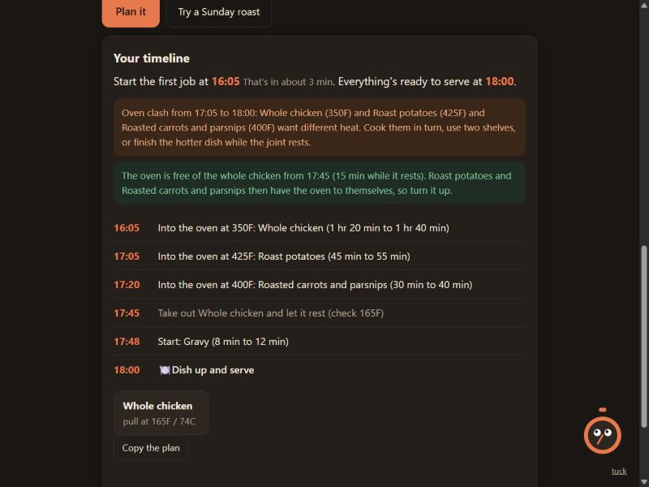

# Readyby

Get every dish ready at the same time. Tell Readyby what you're cooking and when you want to eat, and it works out when to start each dish so the roast, the potatoes and the veg all land together. It plans backwards from your serving time, builds in the rest for the meat, flags when two oven dishes want different heat, and names the temperature to check the joint with. Ding the kitchen timer keeps you company.

**Live:** https://readyby.johanthegoat.xyz



## The problem

Any one dish is easy. The hard part of a roast dinner is landing the meat, the potatoes and the veg at the same moment, because they all take different times and the oven can only be one temperature at once. So people put the potatoes in too early and they go leathery, carve the joint the second it leaves the oven so it bleeds out on the board, or serve cold veg because everything else ran late.

The fix is to work backwards from the time you want to eat, and that is exactly the sum nobody wants to do in their head while juggling four pans.

## What Readyby does

1. **Plans backwards from serving time.** Every dish is scheduled so it finishes when you want to eat. The meats come out of the oven early and rest, so they are carved just as everything else is dished up.
2. **Times the joint by weight.** Roasting times come from the USDA and FoodSafety.gov charts, scaled by the weight you give, and beef and lamb adjust for how pink you like them.
3. **Names the pull temperature, early for carryover.** Poultry 165F, and beef, pork and lamb 145F with a three-minute rest, the USDA safe minimums. A joint keeps cooking after it leaves the oven: its middle climbs a few more degrees while it rests, more for a bigger, hotter roast. So Readyby gives the temperature to take it *out* at (a few degrees under the target) and the temperature it coasts up to while resting, so you hit the doneness you wanted instead of overshooting. A thermometer is the only thing that really tells you a joint is done, so Readyby always shows the numbers to check rather than trusting the clock.
4. **Flags oven clashes.** If two dishes in the oven want different temperatures at the same time, it says so, with the exact minutes and both temperatures, so you can cook them in turn or use two shelves.
5. **Spots the rest window.** While the joint rests out of the oven, the oven is free and still hot. That is the moment for crisp roast potatoes, and Readyby tells you when the gap opens.
6. **Reminds you to put the leftovers away.** Cooked food left in the danger zone (40F to 140F) grows bacteria fast, so the plan ends with the time the leftovers need to be in the fridge: two hours after serving, or one hour if the room is hot (tick the box for a summer table or a warm kitchen).

## How the schedule is built

Each dish has a cooking time and, for the meats, a rest. Readyby sets each dish's finish point (serving time for the sides, serving time minus the rest for the meats) and subtracts the cooking time to get the start. It plans from the longer end of each time range, so you are never caught short, then merges every start and every "take it out to rest" into one ordered list you follow top to bottom.

The oven-clash check walks the minutes the oven is in use and records any stretch where more than one temperature is needed. The rest-window hint fires when a single resting joint frees the oven before serving and other oven dishes are still cooking, so they get the oven, and its full heat, to themselves.

The roasting times and safe temperatures follow published guidance:

- [USDA / FoodSafety.gov meat and poultry roasting charts](https://www.foodsafety.gov/food-safety-charts/meat-poultry-charts)
- [USDA FSIS safe minimum internal temperature chart](https://www.fsis.usda.gov/food-safety/safe-food-handling-and-preparation/food-safety-basics/safe-temperature-chart) (poultry 165F; beef, pork, lamb 145F plus a 3-minute rest; ground meat 160F)
- [FoodSafety.gov "Keep Food Safe" / 2-hour rule](https://www.foodsafety.gov/keep-food-safe/4-steps-to-food-safety) (refrigerate perishable food within 2 hours, or 1 hour above 90F; the 40F to 140F danger zone)
- [ThermoWorks on carryover cooking](https://blog.thermoworks.com/beef-temperatures/) (a roast keeps rising off the heat; pull roughly 3-10F below the target, more for a larger, hotter cut). Readyby uses a per-roast rise of 5-8F for a chicken, 8-12F for a turkey, and 5-10F for beef and pork, which is why the pull temperature is shown as a small window rather than one number.

## Running it

Open `index.html` in a browser. There is no build step and nothing to install.

The logic lives in `src/engine.js` as plain functions with no page code, so the tests cover the same code the page runs:

```
npm test
```

(or `node --test`). CI runs the suite on Node 20, 22 and 24.

## Project layout

- `index.html` and `style.css`: the page.
- `src/engine.js`: the dish catalogue, the time maths, the backward schedule, the oven-clash and rest-window checks. Pure functions.
- `src/ding.js`: Ding the kitchen timer.
- `src/app.js`: wiring between the page and the engine.
- `test/engine.test.js`: the test suite.

## A note on the numbers

Times are estimates and ovens vary. Readyby plans from the longer end of each range and always names the temperature to check, because the thermometer, not the clock, is what tells you the meat is safe and done. It is a planner, not a replacement for one.

MIT licensed.
